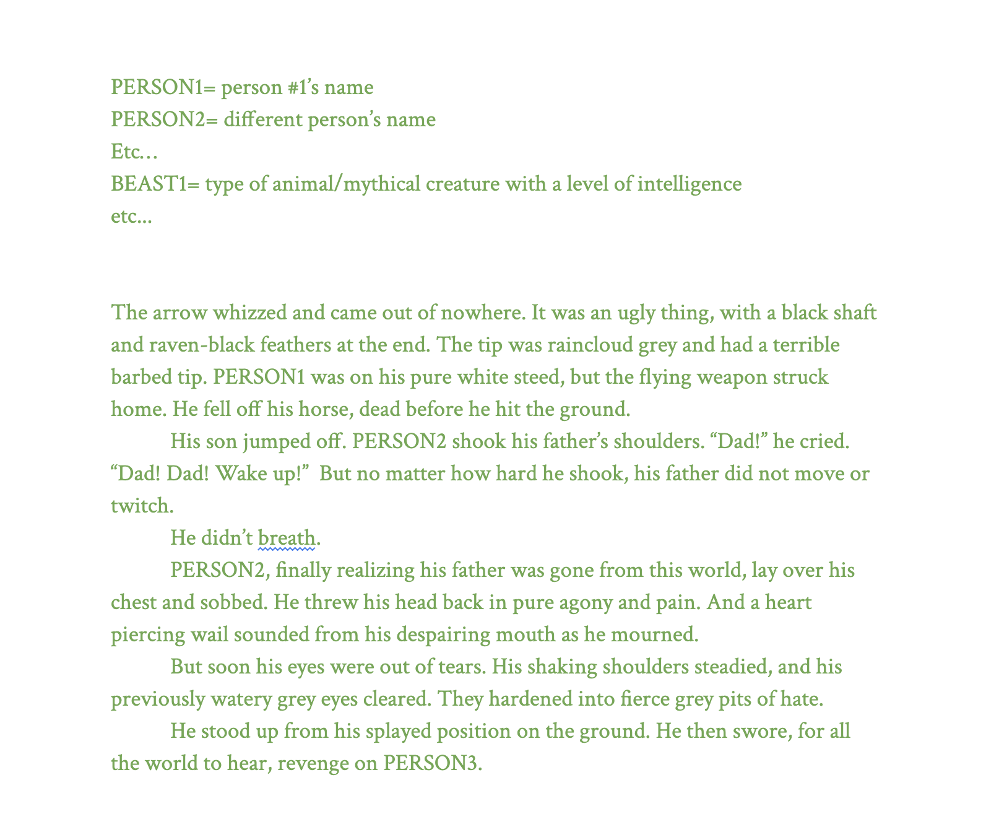
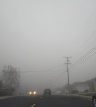

```{=html}
<style>
.column p { margin: 4pt 0; }


.name-heading {
  font-size: 2rem;
  font-weight: 700;
  letter-spacing: 0.05em;
  text-transform: uppercase;
  margin: 5% 0 10px 0;
}

.body {
  font-size: 0.8em;
}


.tile-grid {
  display: grid;
  grid-template-columns: 1fr 1fr;  /* 2 tiles per row */
  gap: 12px;
}

.tile {
  position: relative;
  display: block;
  aspect-ratio: 1 / 1;             /* keeps it square */
  overflow: hidden;
  border-radius: 0px;
}

.tile img {
  width: 100%;
  height: 100%;
  object-fit: cover;               /* crops to fill the square */
  margin: 0;
  transition: transform 0.3s ease;
}

.tile:hover img { transform: scale(1.06); }

.tile span {
  position: absolute;
  left: 0; right: 0; bottom: 0;
  padding: 18px 8px 8px;
  color: #fff;
  font-weight: 600;
  letter-spacing: 0.08em;
  text-align: center;
  background: linear-gradient(transparent, rgba(0,0,0,0.65));
}


</style>
```

::: name-heading
LEFT FIELD
:::

::::::: columns
::: {.column .body width="45%"}
The earliest piece of writing that I can find in my Google Drive is when I was twelve. At the risk of coming off like a recipe blog with useless preamble, I want to note that it's a little gratifying to see that ten years later, my writing quality has improved a bit.

{.framed fig-alt="Screenshot of my earliest writing" width="100%" fig-align="center"} Generally speaking, it's become little less dramatic, and I'm also better now at deciding on names as opposed to using PERSON1 placeholders. My spelling blindspots continue to surprise me though, and I can't say if my writing now has improved more as a result of what I read, as opposed to practicing the craft. Sometimes I write and write and write, and rereading such pieces makes me understand why some people believe that God is speaking through them. Brigham Young and I, two peas (prophets?) in a pod. Not that there is something especially profound or life-changing in any one piece, but that it feels like an alter ego or clone wrote it, not me.

However intentional it is, writing has always been a place of expression for me, and after taking one of my last general education classes in university on writing, I was moved by good teaching (thank you Nico!), good reading, and great conversation with my classmates to dig a little deeper into it and to also perhaps share with those around me. May something within my ramblings bring you some sort of deeper thought, or at the very least, a chuckle.\
- katinka
:::

::: {.column width="5%"}
:::

:::: {.column width="50%"}
::: tile-grid

<a class="tile" href="pieces/on-the-uses-of-grief.html">
  
  <span>The Uses of Grief</span>
</a>

<a class="tile" href="pieces/after-school.html">
  
  <span>After School</span>
</a>

<a class="tile" href="pieces/zines/zine_index.html">
  
  <span>Zines (series)</span>
</a>

<a class="tile" href="pieces/searching-for-truth.html">
  
  <span>Searching for Truth</span>
</a>

:::
::::
:::::::
