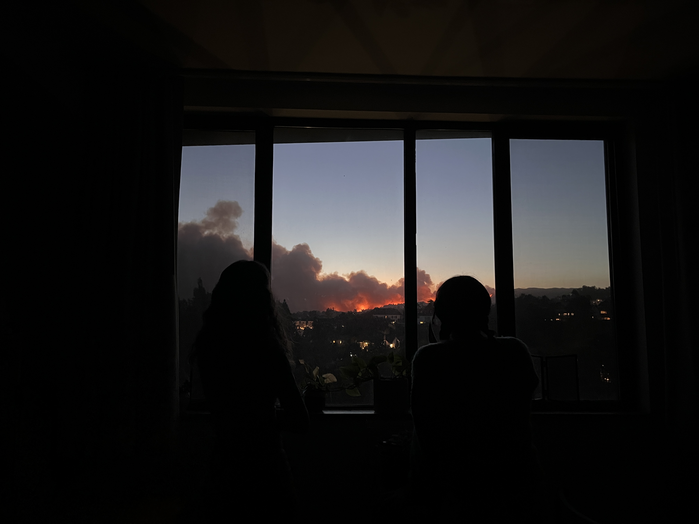

Something that reliably grinds my gears: bestowed faith upon our generation that we will solve The Climate Change Issue. It comes usually in the form of well meaning older adults seeing some motivated kids doing something—anything, really—that is vaguely environmental. Extra points if you are young. Extra extra points if you involve other people! Extra extra extra points if you do something that an adult was supposed to do!

“Oh my, you are so smart and talented and I have so much faith in you to solve climate change! It’s the biggest problem of your generation!”

Biggest. Problem. Of my generation.

(Dear reader: I hope you can tell that this is a touchy subject.)

I have nothing against the people who espouse these sentiments, but the rollercoaster of grief that I’ve gone through from being born into a world I’ve been told is going to go up in flames within my lifetime, to be so trivially absolved to be a problem of my generation– it does piss me off just a bit.

Let’s Marty McFly this back to, say 2016. Flashback to me, sitting in 6th grade science class, learning about climate change. Glaciers, emaciated polar bears, the little greenhouse gas-earth diagram with the reflecting sun rays if you know what I’m referring to: “Congrats, this nice world you grew up in isn’t going to exist in fifty years!”

But no shock there. When you’re young, you swallow things whole as they come. As such, I wasn’t even allowed the liberty of shock when learning about climate change. Climate change was taught as a fact of life. Unit 6: Photosynthesis, followed by Unit 7: Existential Threat to the Future. (Side note/silver lining: climate change education may be a little different now.

We know more about the problem and know a little more about what to do to fix it, or at least a roadmap of goals we must hit, so hopefully education isn’t so doom-and-gloom anymore and is hopefully a little more trauma-informed. But this is dependent on where you grew up and the education system there. I digress.)

But onto the next stage: anger. Luckily, given the ubiquitous nature of carbon dioxide emissions, there is no shortage of people to blame: “Look at Big Oil! They knew in the 1950s, why didn’t they do anything! Look at policy makers, they aren’t lifting a finger! Look at the lousy, unscientific Republicans! Look at the fear-mongering Democrats!”

Yet how can you really blame one person? Each person only does the best that they can do. It’s really the overlapping systems of values and economic growth that have caused us to get where we are today…But at what point does a group of people become a system? Where does the line of responsibility get drawn? Anger either becomes diffuse, withering into gray apathy, or it becomes accusatory and fingerpointing toward pieces of the puzzle that don’t really compromise the whole. This is one that took me a long time to learn, often with a lot of internalized resentment toward various bad actors that really just were acting as expected within the constraints of our society.

Ok, what’s next? Bargaining: “Here’s the deal: climate change is very much a huge problem, primarily caused by global warming. It comes from everybody’s carbon footprint! So, if you reduce your own carbon footprint, you’ll be doing your part to save the planet!”

A real hole was popped in this bubble when I learned that fossil fuel companies were the ones who popularized this “carbon footprint” concept, potentially to shift blame from organizations to individuals. As I learned more about the problem and different frameworks of blame, the reality of bargaining shifted frequently: from hoping that everyone would change their behavior, to hoping that the five biggest polluting companies would be shut down, to hoping that law makers would be the ones to save us. I mean, there are so many people who could take action.

Despair strikes when I think about all the loss that is happening, that is going to happen. How do you live in a town thinking it’s going to be underwater in a few years? How do you build a house thinking it’ll just burn down? Planning for the future becomes difficult, if not pointless.

But consider finally, acceptance: “Look at this problem of your generation–you all are going to do so well in solving it!” When it’s put like that, it sure feels like a problem of my own generation! When responsibility is placed on my shoulders like that, a moment of panic and rejection ensues. A part of me also feels a sense of injustice: if I was never allowed the luxury of faith in my forebearers to provide a stable world to live in, why should I entertain the faith that my generation will right these wrongs?

You can probably spy a common thread throughout this entire process: given massive, entropic problems pervasive across space and time, the accompanying emotions are hard to process and difficult to logic out. As such, touching on climate change can often be like opening a Pandora’s box, a Thanksgiving table off-limits topic. It’s made thinking about this problem really difficult to process. Do I care about climate change? Yes, technically. But not in the same way I care about the well being of my family, or the way I care about feminist representation. There’s too many emotions to consider. So sometimes it’s easier just to put it all away.

And while you might criticize me for this perhaps avoidant mentality, what I’d really like to ask for is some optimism. Some allies who acknowledge we’re all in this dumpster fire together. No pity party, no gold stars for effort please, just a little “Let’s get to work.” Maybe that way we can move beyond the grief of mourning the future that has been lost, and start thinking about building a future.

Cheap, abundant energy from towering offshore wind turbines. Non-monoculture (multicultural?) farming. State firefighters working with indigenous tribes on wildfire management. Space elevators, geo-engineered carbon removal, lab-grown salmon, ranked-choice voting! Maybe all of this isn’t realistic, and maybe not all of it floats your boat, but let’s start dreaming and building–together. 

[◄ home](../index.html){.home-btn}