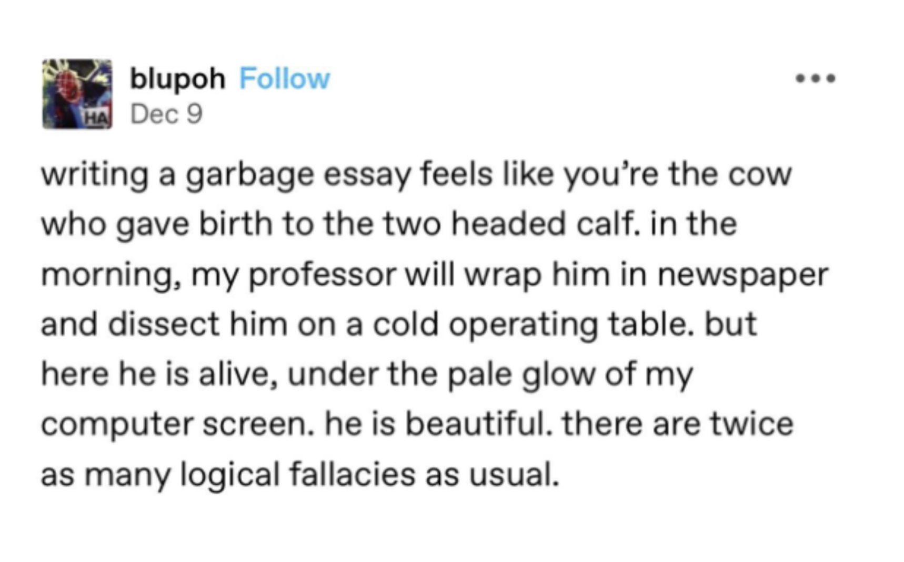

{width=60%}

On My Oral Hygienist 

A 9am appointment I am never mentally ready for  
After 11am starts to my day in school, a 9am really feels like a 7am  
Too early to muster up the energy to small talk, too late to have an excuse to sit in the dentists chair   
Face slack, eyes glazed  
(and too old to boot)  
Staring ideally at the fish painted on the ceiling  
But really, what I want to do is stare into the eyes of my hygienist.  

Okay, not like that!   
She (Joanne?) always has mascara on, which I just want to peruse the application of  
Without the forced intimacy of prolonged eye contact  
Or giving myself the reputation of Patrick Bateman serial killer energy  
She has gray eyes too  
Or maybe blue  
See, I would know for sure if more solid eye contact was made! But it is not to be.  
\

INTERMISSION  
On Emails 

Answering emails was a scary, procrastinating task   
To unpack, it probably relates to taking responsibility, accountability, or irrevocability    
But:  

At some undetermined point in time,   
I suddenly became The Emailer, not the Emailee  
Being the replier has become a thing of the past  
A sheep morphed into a wolf, puzzled by this transformation  

(the Öh My God Why Must I Answer This Email feeling has become replaced by a new sinking-stomach sensation, called Oh My God Why Isn’t There An Unsend Email Option)  

Anyhow  
I think I lose a little bit of humanity every time I google   
“Template for follow-up emails”  
The very best corporate secretary in me comes out, an alternate timeline of being an overworked assistant working at the front desk  
(of the Runway Magazine?)  
Working (for….Miranda Priestly?) Ideally, the best dressed in the office  
Living out a 2006 comedy-drama dream  
\

12.18.2023  
One of my favorite markers of casual intimacy is telling friends I made some food today with something that they’re allergic to. (e.g., almonds biscotti to the poor oafs allergic to nuts.) I think it’s neat to remind them that (a) I know what kills you (b) and I opted not act on it, at least today  
\

###### 1 &ensp; [2](zine2.html) &ensp; [3](zine3.html) &ensp; [4](zine4.html) &ensp; [5](zine5.html)
\
[◄ home](/){.home-btn}
