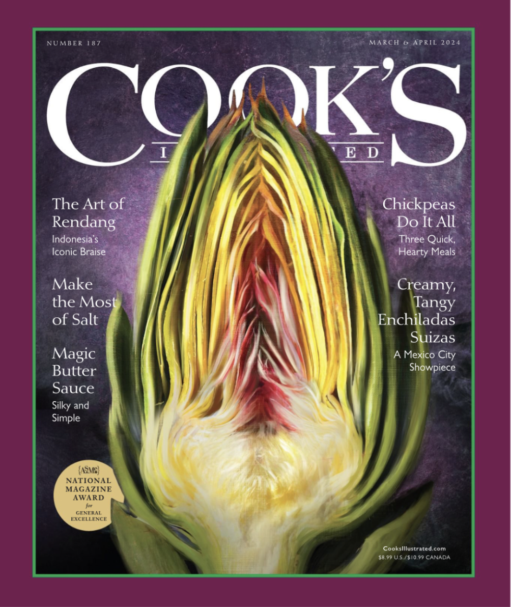

{width=30%}

Saturday 11:57pm\
Here’s to a zine, zine 2, zine 2.0, the second of the lot\
(The 2 suggesting some sort of progression, but really the best zines I argue are a digression, so the linear relationship of numbers fail to encapsulate the spiraling and meandering\
A lack of relation between these, let’s be honest, even with the author)\

Here’s to looking at things, \
Twice!\
Like this artichoke here\
Escaped my judgement unscathed the first time\
But a second look has me thinking a little too much about vaginally reminiscent objects\
Second look, second thought—\

Hm.\
Second thoughts are never as punchy as first thoughts\
Nor as rational as the third\
But they are arguably the most interesting of the lot\
And belong best on a napkin or in the notes app, \
To be mulled on by third thoughts,\
Masticated by fourths,\
And unfortunately ruined by fifths, so really they should be kept under wraps and not considered too strongly \

Saturday 1:04am\
Sometimes when I look at small kids, I get the feeling that they are the only thing Inherently good and true left in this world\
Everyone else around is old\
Jaded\
Their diverging fig’s tree of a path, easily judged\
What they chose to do, what they have not\
\

###### [1](zine1.html) &ensp; 2 &ensp; [3](zine3.html) &ensp; [4](zine4.html) &ensp; [5](zine5.html)
\
[◄ home](/){.home-btn}
