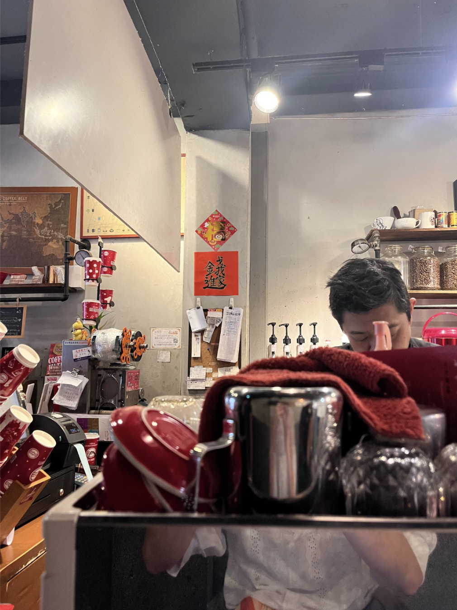

April 30, 2026. 9:34AM.

Feeling like a serif font today. Also feeling the fucked up Google Docs margins today, although that bit wasn’t by design. Feeling like a paragraph format too! No artsy line breaks today. ALSO feeling caffeinated—I got a latte at the coffee shop, and since my desire to flex my Chinese was larger than my desire for a flat white, the extra liquid is sloshing around in my empty gut like a laxative promise. (Superb coffee by the way, beans are roasted and ground on site and they have floppy sacks of coffee beans as decor on the side to emphasize this). This place is sitting at the bottom of a hostel, and because of this fact, I get to people-watch all the white people speak Chinese, perhaps as good as me! No way to tell through the short interaction of a coffee order, but I like to imagine.

Can you tell I’m caffeinated with that paragraph? I suspect that if I don’t write and post this all in one go, this zine will perish within the depths of draft untitled documents. I’m also in the midst, as per usual, of avoiding additional responsibilities in favor of what I like to think of as Creative Expression And The Recording of Life Lived.

{width="45%" fig-align="left"}

Perhaps the cappuccino is a good way to stress test my lactose intolerance. Risky business while travelling to be honest but given the accessibility of public bathrooms in Taiwan, perhaps not so bad after all. Anyhow: on the to-do list (which really manifests as a to-avoid list) is answering two emails, the first which was sent to me two days ago and the second which was sent to me two weeks ago, a job application, a survey to fill out, a school bill to pay, and another email (whoops) that I forgot to account for earlier in this sentence, sent to me sometime last night. The post-grad feeling is that of the constant loose ends. But tying loose ends that I to be fair am the origin of, so I’m not complaining.

A couple just came up to the counter. By the shape of their noses, I think they’re siblings, but they’re also about 70 years old so I wonder who is travelling with their siblings at that age? Hopefully me! I’ve also heard the theory that couples grow to look like each other with age. But bone structure seems like a bit of a stretch. Perhaps they got matching rhinoplasties.

Enough speculation though…this open Google Doc has the aura of work at this coffee shop, but time to actually get back to work. I hope I come across a cat today.\

###### [1](zine1.html)   [2](zine2.html)   [3](zine3.html)   [4](zine4.html)   5
\
[◄ home](/){.home-btn}
